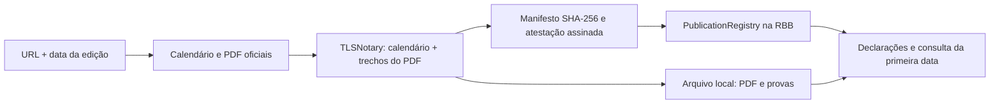

# registro-TLS-rbb

Piloto de registro de publicações oficiais do **TCE-SP** na **Rede Blockchain
Brasil, testnet**. A aplicação recebe uma URL e a data da edição, autentica o
calendário e os bytes do PDF com TLSNotary, calcula SHA-256 e registra hashes e
datas em um contrato Solidity. Consultas posteriores retornam o primeiro registro
daquela URL e edição, sem depender de uma nova busca no site do TCE.

Inclui aplicativo local, contratos para Remix, assinatura interativa com MetaMask,
executor de lotes e uma subaba persistente de declarações, transações e evidências.



## Alcance da prova

- A primeira data é o timestamp da inclusão inicial **neste contrato**. A data da
  edição e a publicação declarada pelo documento são campos separados.
- Coletar hoje uma edição antiga não prova que ela estava disponível no passado.
- O piloto executa prover, notary e verificador localmente. Não é um serviço de
  notary independente da Ethereum Foundation.
- O contrato valida uma atestação EIP-712 do verificador autorizado. A verificação
  TLSNotary ocorre fora da cadeia; o contrato não verifica uma prova zkTLS nativa.
- As apresentações revelam o conteúdo público completo. Este fluxo não implementa
  ocultação seletiva do documento.
- PDF, manifesto e provas ficam no disco do operador. A blockchain guarda hashes,
  datas e eventos. Persistência local não substitui backup.

## Instalar e abrir

Requisitos: Node.js 22 ou posterior e npm. Para gerar provas: Rust com suporte à
edition 2024, Cargo, compilador C e `pdftotext` (Poppler). Os testes de contrato
precisam de `anvil` (Foundry) no PATH.

```sh
git clone --recurse-submodules https://github.com/Zeugh-eth/registro-TLS-rbb.git
cd registro-TLS-rbb/registry
npm ci
npm start
```

Abra **http://127.0.0.1:8787/**. O servidor escuta somente em loopback.
`npm start` compila os contratos e prepara os arquivos JavaScript do navegador.

| Página | Função |
| --- | --- |
| `/` | Buscar PDF, gerar prova e consultar URL + edição |
| `/declaracoes` | Lotes, registros confirmados, metadados, downloads e JSON/CSV |
| `/hash` | Registro simples de hash, usando o contrato legado DocumentRegistry |

A configuração pública permite consultar o contrato de referência sem chave
privada. Um clone novo não contém o acervo de PDFs e provas do operador original:
recupera metadados on-chain e indica os pacotes locais ausentes.

## Configurar a coleta TLSNotary

O submódulo está fixado em TLSNotary `v0.1.0-alpha.14`, commit
`9a3d73c5bdeeab0255bdb05c89116554cebf6dbe`.

```sh
# Na raiz do repositório, se o clone não incluiu os submódulos:
git submodule update --init --recursive
cd registry
cargo build --release --locked --manifest-path tlsn-adapter/Cargo.toml
node scripts/setup-publication.mjs
npm start
```

O setup cria novas chaves locais de notary e verificador em `registry/state/`,
com acesso restrito, e mostra apenas o endereço público do verificador. Essas
chaves não são as da instalação de referência. Para registrar novas atestações,
publique seu contrato com o verificador correspondente e configure seu endereço
e bloco de deploy em `state/publication-config.json`. Consulte
[o fluxo de publicação](docs/PUBLICATION.md).

## Rede e contrato de referência

| Campo | Valor |
| --- | --- |
| Rede | RBB Testnet |
| Chain ID | `648629` |
| Contrato | `0xdC0c47925AD2d85626027cE773A4db9d19Cac569` |
| Writer autorizado | `0x43C530588209aC49C1FC6987Af930B9077168Fdb` |
| Verificador | `0xc5F79B0cEEbD34412a7a1dEd28912be983580849` |
| Algoritmo do documento | SHA-256 dos bytes originais |
| Identidade da fonte | Keccak-256 da URL canônica |

Esses endereços são públicos. O repositório não contém chaves dessas contas.
A leitura é pública; a escrita exige a carteira e o verificador autorizados.
O executor de lote é deliberadamente restrito à implantação de referência.

O transporte padrão, sem configuração privada, usa diretamente o RPC público da
testnet. Para usar uma Raspberry Pi como transporte via SSH/Tailscale, copie
`operations/networks.example.json` para `operations/networks.json`, preencha
`ssh_target` com seu próprio destino e use `RBB_RPC_TRANSPORT=ssh`. O SSH exige
host key conhecida e modo não interativo. Uma falha nunca troca automaticamente
de transporte nem reenvia uma transação de resultado incerto.

O observer de chain ID `12120014` é outra rede e não substitui a testnet `648629`.

## Testar

Com Anvil no PATH e o adaptador TLSNotary compilado:

```sh
cd registry
npm test
```

Os testes usam EVMs locais efêmeras e uma apresentação TLSNotary pública de teste.
Não carregam a chave de escrita do operador nem enviam transações à RBB.
Cobrem primeira data imutável, versões, assinaturas, transporte, lote retomável,
arquivo persistente, downloads, falhas de RPC e validação offline da apresentação.

## Documentação

- [Publicação, contrato e confiança](docs/PUBLICATION.md)
- [Respostas assinadas pelo servidor (RFC 9421), sem notary](docs/SIGNED.md)
- [Instalação em outra organização, guia para agentes](docs/AGENT_INSTALL.md)
- [Lotes e retomada](docs/BATCH.md)
- [Declarações, persistência e consultas](docs/DECLARATIONS.md)
- [Dependências e licenças existentes](THIRD_PARTY.md)

Chaves, `.env`, configurações SSH, bancos locais, logs, PDFs coletados, provas de
execução e relatórios privados ficam fora do Git. O acervo da aplicação é mantido
localmente; publicar o código não faz upload desse acervo.
